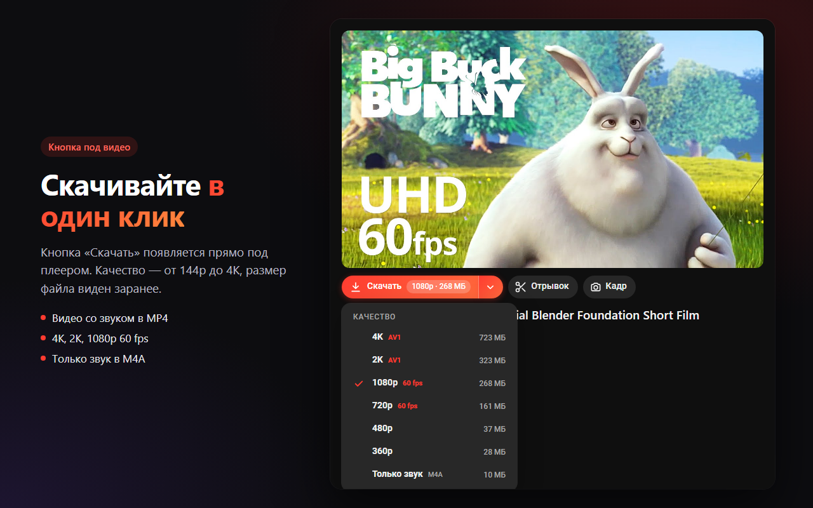
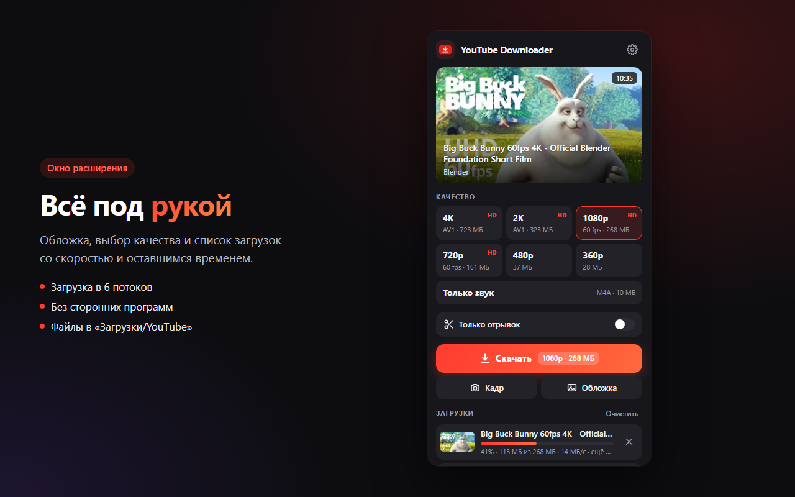
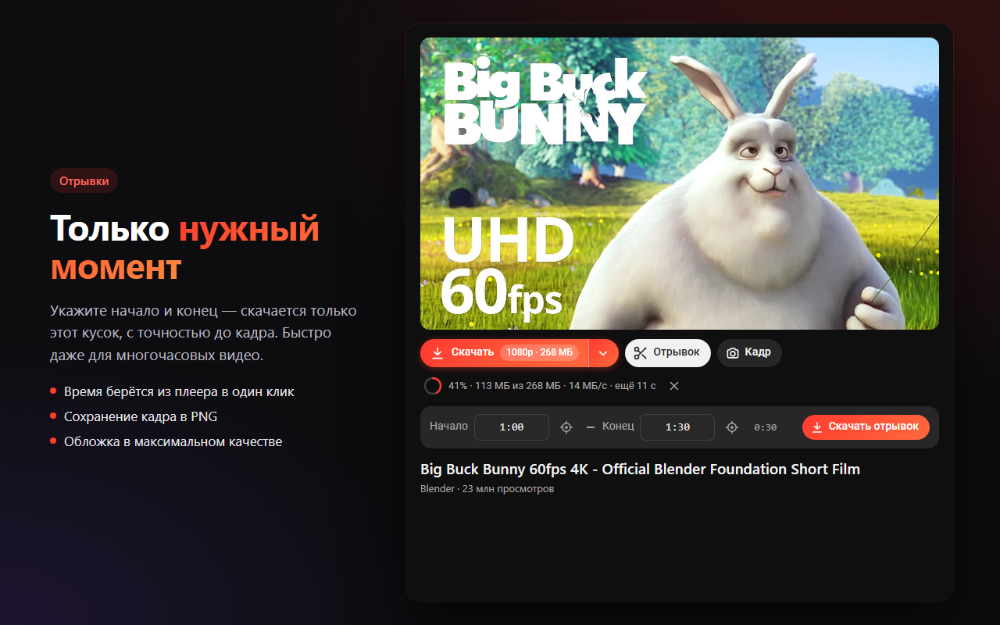

<p align="center">
  
</p>

<h1 align="center">Сохрани видео</h1>

<p align="center">
  Расширение для Firefox: скачивание видео с YouTube до 4K со звуком —<br>
  прямо в браузере, без сторонних программ.
</p>

<p align="center">
  <b>Русский</b> · <a href="README.en.md">English</a>
</p>

<p align="center">
  <a href="https://addons.mozilla.org/ru/firefox/addon/ytdl-4k-clips-frames/"><b>Установить из каталога Firefox →</b></a>
</p>

<p align="center">
  
</p>

## Возможности

- **Кнопка «Скачать» под каждым видео.** Меню качества — 4K, 2K, 1080p … 144p или только звук, размер файла виден заранее.
- **Окно на панели браузера.** Обложка, название, выбор качества и список загрузок с прогрессом, скоростью и оставшимся временем.
- **Отрывок.** Укажите начало и конец — скачается только этот кусок, с точностью до кадра. Загружаются только нужные фрагменты, поэтому это быстро даже для многочасовых видео.
- **Кадр.** Текущий кадр сохраняется в PNG в полном разрешении.
- **Обложка.** Превью видео в максимальном качестве.
- **Быстро.** Загрузка в 6 потоков.
- **Без потери качества.** Видео и звук склеиваются в обычный MP4 без перекодирования: до 1080p — H.264, выше — AV1. Только звук — M4A.
- **Без лишнего.** Не нужно ставить программы, не собираются никакие данные, расширение обращается только к серверам YouTube.

Файлы сохраняются в папку «Загрузки/YouTube». В настройках окна можно включить «Спрашивать, куда сохранить файл».

## Скриншоты

| Окно расширения | Отрывок |
|---|---|
|  |  |

## Установка

**Из каталога Firefox** (рекомендуется): [addons.mozilla.org](https://addons.mozilla.org/ru/firefox/addon/ytdl-4k-clips-frames/) → «Добавить в Firefox».

**Из исходников** (для разработки):
1. Скачайте репозиторий.
2. Откройте `about:debugging#/runtime/this-firefox`.
3. Нажмите «Загрузить временное дополнение…» и выберите `extension/manifest.json`.

Временное дополнение работает до перезапуска Firefox.

## Как это работает

Всё происходит внутри расширения, без сервера и без внешних программ.

1. **Ссылки на потоки.** [`lib/youtube.js`](extension/lib/youtube.js) запрашивает у внутреннего API YouTube (`youtubei/v1/player`) данные о видео от имени клиента `VISIONOS` — того же, что использует yt-dlp. Этот клиент отдаёт прямые ссылки на видео и звук без расшифровки подписей.
2. **Загрузка.** [`background.js`](extension/background.js) качает видео и звук параллельно кусками по 8 МБ в 6 потоков. Для отрывка сначала читается индекс фрагментов (`sidx`), и скачиваются только те фрагменты, что попадают в нужный интервал.
3. **Склейка.** [`lib/mp4.js`](extension/lib/mp4.js) — небольшой ремуксер на чистом JavaScript. Он разбирает фрагментированные MP4 от YouTube и собирает из них обычный MP4 с обеими дорожками, без перекодирования. Для отрывка лишние кадры до начала скрываются списком правок (`edts`), поэтому отрывок начинается ровно с указанного момента.
4. **Сохранение.** Готовый файл отдаётся браузеру через API загрузок.

### Структура

```
extension/
├── manifest.json
├── background.js     загрузка, очередь, сохранение файлов
├── content.js/.css   панель с кнопками под видео
├── popup.html/.css/.js  окно расширения
├── common.js         общие функции и иконки
├── lib/
│   ├── youtube.js    получение информации и ссылок на потоки
│   └── mp4.js        склейка видео и звука в MP4
└── icons/icon.svg
```

## Сборка

Нужен Node.js.

```bash
npx web-ext lint -s extension
```

```bash
npx web-ext build -s extension -a dist
```

Готовый архив появится в папке `dist/`.

## Если перестало качать

YouTube время от времени меняет внутренний API. Параметры клиента находятся в начале [`lib/youtube.js`](extension/lib/youtube.js) — обычно достаточно обновить их по актуальной версии yt-dlp. Сообщения о проблемах — в [Issues](../../issues).

## Отказ от ответственности

Расширение предназначено для сохранения видео, на которые у вас есть права: собственных роликов, видео под свободными лицензиями и т. п. Соблюдайте авторские права и условия использования YouTube. Проект не связан с YouTube и Google.

На скриншотах — кадры из мультфильма [Big Buck Bunny](https://peach.blender.org/) © Blender Foundation, лицензия CC BY 3.0.

## Лицензия

[MIT](LICENSE)
